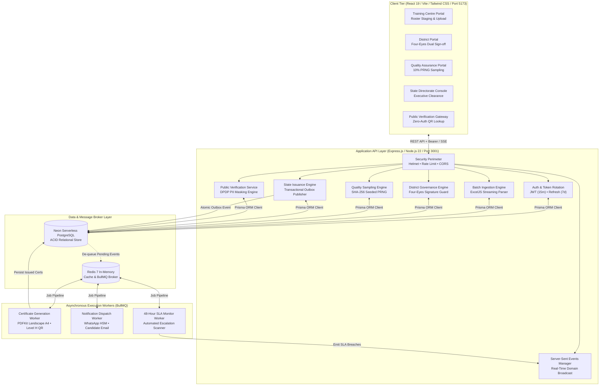
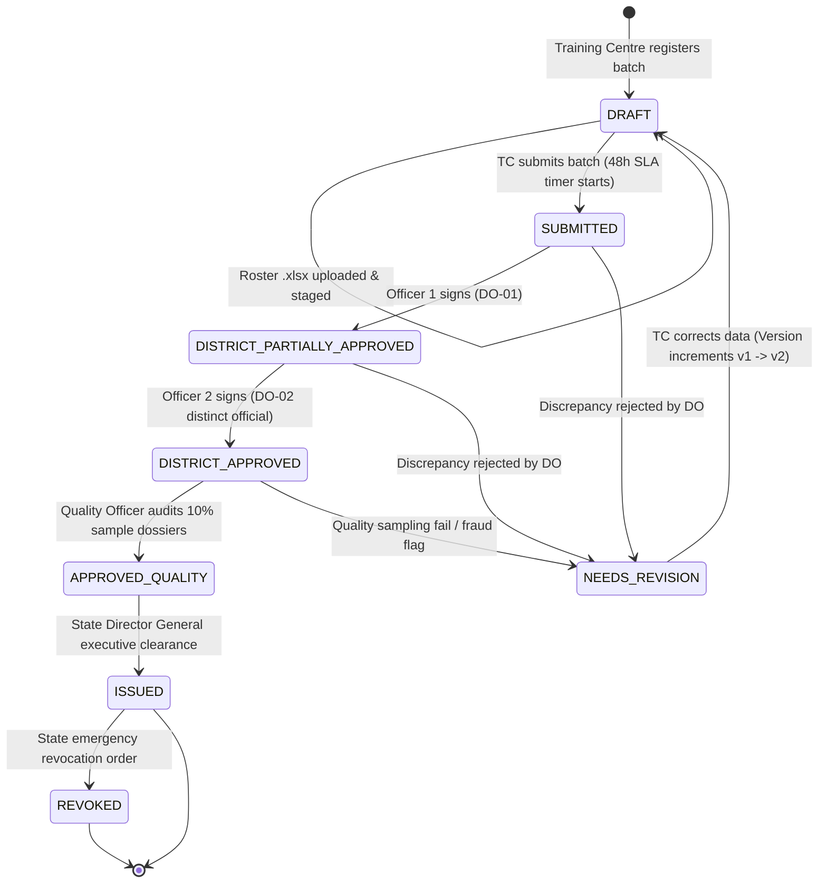
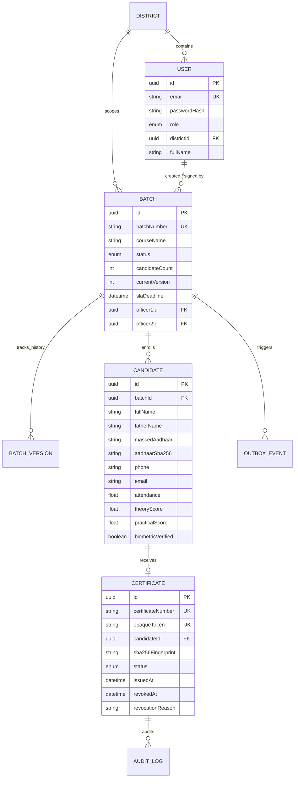
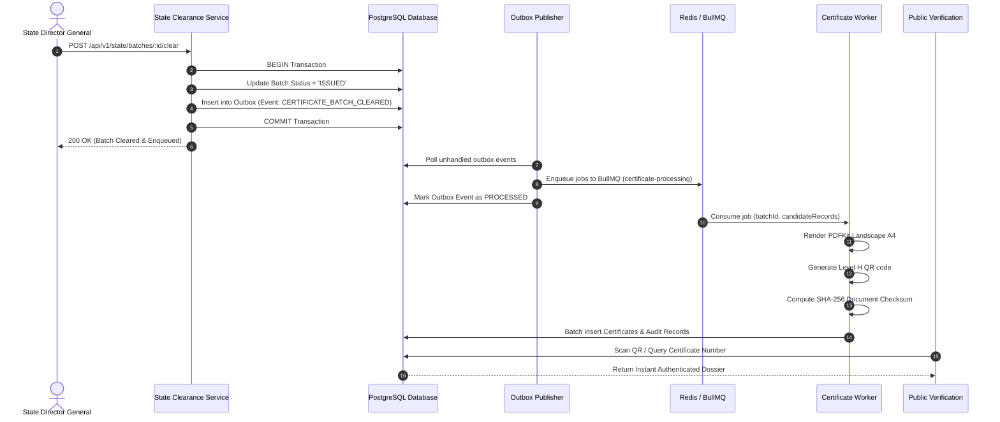
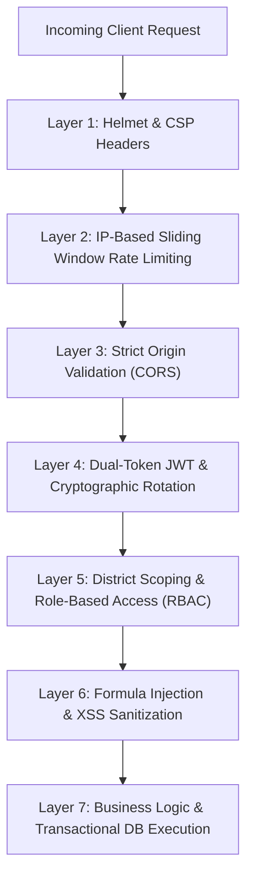

# CertiFlow — Technical Architecture & System Design Document

> **Enterprise-Grade, Tamper-Evident Digital Credential Issuance & Multi-Tier Verification Infrastructure**  
> Compliant with the National Council for Vocational Education and Training (NCVET) statutory standards and the Digital Personal Data Protection (DPDP) Act 2023.

---

## Table of Contents

1. [Executive Summary & High-Level Architecture](#1-executive-summary--high-level-architecture)
2. [Monorepo Workspace Topology](#2-monorepo-workspace-topology)
3. [Four-Tier Governance & Batch State Machine](#3-four-tier-governance--batch-state-machine)
4. [Relational Data Model & Prisma Schema](#4-relational-data-model--prisma-schema)
5. [Asynchronous Processing, Outbox & Queue Architecture](#5-asynchronous-processing-outbox--queue-architecture)
6. [Real-Time Event Notification Architecture (SSE)](#6-real-time-event-notification-architecture-sse)
7. [Security Perimeter & Threat Defenses](#7-security-perimeter--threat-defenses)
8. [Verifiable Credential Rendering & Typography Engine](#8-verifiable-credential-rendering--typography-engine)
9. [Public Verification Gateway & DPDP Privacy Shield](#9-public-verification-gateway--dpdp-privacy-shield)
10. [Infrastructure, Observability & Deployment Topology](#10-infrastructure-observability--deployment-topology)

---

## 1. Executive Summary & High-Level Architecture

CertiFlow is architected as an end-to-end, multi-tier skilling credential governance platform designed to eliminate fraudulent credential issuance in vocational education. It orchestrates a decentralized yet strictly audited four-tier verification lifecycle, cryptographically links candidate assessments to physical/biometric audit records, and produces tamper-evident digital certificates with instantaneous public QR verification.

### System Architecture Diagram



---

## 2. Monorepo Workspace Topology

The repository follows a clean npm workspaces architecture, separating business logic, frontend UI, backend services, and domain contracts.

```text
certiflow/
├── apps/
│   ├── frontend/                    # Client application (React 19, Vite, Tailwind CSS, shadcn/ui)
│   │   ├── src/
│   │   │   ├── components/layout/   # AppShell, PublicVerificationShell
│   │   │   ├── components/ui/       # Accessible UI atoms & CertificatePreviewModal
│   │   │   ├── pages/               # Multi-role portals (TC, District, Quality, State, Public)
│   │   │   ├── lib/                 # batchStore (localStorage sync), pdfDownloader, excelClientReader
│   │   │   └── hooks/               # useEventStream (SSE), react-query mutations
│   │   └── vite.config.ts           # Development proxy & build optimizer
│   │
│   └── backend/                     # Enterprise runtime (Node.js 22, Express, Prisma, BullMQ, PDFKit)
│       ├── prisma/
│       │   ├── schema.prisma        # Relational schema (neon / postgresql)
│       │   └── seed.ts              # Pre-seeded master test directories
│       └── src/
│           ├── config/              # Database (Prisma), Redis, Environment (Zod)
│           ├── middleware/          # auth, security, errorHandler
│           ├── modules/             # auth, batches, district, quality, state, verification, reports, events
│           ├── workers/             # certificateWorker, notificationWorker, slaWorker
│           └── utils/               # jwt (crypto rotation), hasher (bcrypt 12 rounds)
│
├── packages/
│   └── shared/                      # Shared contracts between apps
│       ├── src/
│       │   ├── types.ts             # Domain interfaces, Role enum, BatchStatus enum
│       │   ├── validation.ts        # Zod runtime boundary validation schemas
│       │   └── tokens.ts            # Design tokens & color palettes
│       └── package.json
│
├── sample_candidate_roster.xlsx     # Pre-validated candidate test workbook
├── CertiFlow_Batch_Upload_Template.xlsx # Clean, standardized 8-column ingestion template
└── docker-compose.yml               # Multi-service container orchestration
```

---

## 3. Four-Tier Governance & Batch State Machine

CertiFlow enforces **NCVET Four-Eyes Governance** where no single official possesses the unilateral authority to issue credentials.

### Finite State Machine (FSM)



### SLA Escalation Rules
* **48-Hour District Window**: Every batch submitted to the District Tier starts a 48-hour hardware countdown.
* **Automated Breached SLA**: If Officer 1 or Officer 2 fails to record a digital signature within 48 hours, the background `slaWorker` flags the batch as `OVERDUE` and dispatches a high-priority event to the State Monitoring Console.
* **Dual-Sign Enforce Guard**: In production, Officer 2 cannot be the same user ID as Officer 1 (`b.officer1Id !== b.officer2Id`), ensuring an independent audit check.

---

## 4. Relational Data Model & Prisma Schema

The relational schema is configured for PostgreSQL (Neon Serverless compatible) with strict referential integrity and database-level enum constraints.



---

## 5. Asynchronous Processing, Outbox & Queue Architecture

To guarantee zero certificate loss under heavy concurrent batch clearances, CertiFlow adopts the **Transactional Outbox Pattern** coupled with BullMQ and Redis.



---

## 6. Real-Time Event Notification Architecture (SSE)

CertiFlow implements lightweight, battery-efficient Server-Sent Events (SSE) via `/api/v1/events/stream` to broadcast status updates across dashboards without client-side polling.

* **Connection Negotiation**: Supports both standard HTTP Bearer tokens and query-parameter tokens (`?token=<JWT>`) required by browser `EventSource` instances.
* **Domain Event Channels**:
  * `BATCH_UPDATED`: Triggers when batches are submitted, signed, or revised. Automatically invalidates TanStack Query keys across all dashboards.
  * `SLA_BREACHED`: Dispatched by the background SLA scanner when 48 hours lapse without dual approval.
  * `CERTIFICATES_ISSUED`: Notifies training centers that certificates are generated and available for distribution.
* **Heartbeat & Resiliency**: Emits a periodic `:heartbeat` comment every 30 seconds to prevent reverse-proxy timeouts (e.g. Nginx, Cloudflare).

---

## 7. Security Perimeter & Threat Defenses

CertiFlow implements Defense-in-Depth against the OWASP Top 10 API Security Risks:



### Key Security Safeguards
1. **Password Storage**: `bcrypt` with **12 salt rounds**, strictly enforced in [hasher.ts](file:///c:/Users/anil3/OneDrive/Documents/Algohire-hackathon/apps/backend/src/utils/hasher.ts).
2. **Refresh Token Rotation & Reuse Detection**:
   - Refresh tokens are single-use cryptographic tokens stored with their SHA-256 hash in PostgreSQL.
   - When refreshed, the current token is revoked and a new pair is issued.
   - If an already-revoked refresh token is presented, CertiFlow triggers a security breach event, invalidating all active sessions for that user family.
3. **DPDP Act 2023 Citizen Privacy Shield**:
   - Citizen Aadhaar numbers are never stored in plaintext.
   - At the instant of Excel ingestion, raw 12 digits are normalized, validated via Verhoeff algorithm, hashed via SHA-256 (`aadhaarSha256`), and stored strictly as a masked string (`XXXXXXXX1245`).
   - Public verification APIs expose zero Aadhaar data or raw biometric vectors.
4. **Formula Injection Sanitization (CSV / Excel)**:
   - Export engines automatically prepend a single quote (`'`) to any cell value beginning with `=`, `+`, `-`, or `@`, neutralizing CSV/Excel DDE injection attacks.

---

## 8. Verifiable Credential Rendering & Typography Engine

CertiFlow features an authentic, regulatory certificate layout modeled after national skills qualification frameworks.

```text
┌────────────────────────────────────────────────────────────────────────────────────────┐
│  ╔══════════════════════════════════════════════════════════════════════════════════╗  │
│  ║ [GOVERNMENT OF INDIA]              CERTIFLOW NATIONAL REGISTRY   [ID: CF-2026..] ║  │
│  ║                                      NCVET • MSDE               [QR CODE LEVEL H]║  │
│  ║                                                                                  ║  │
│  ║                                Certificate of Competency                         ║  │
│  ║                                                                                  ║  │
│  ║                               THIS IS TO OFFICIALLY CERTIFY THAT                 ║  │
│  ║                                                                                  ║  │
│  ║                                    CANDIDATE FULL NAME                           ║  │
│  ║                                                                                  ║  │
│  ║          HAS DEMONSTRATED PROFICIENCY AND COMPLETED THE ACCREDITED QUALIFICATION ║  │
│  ║                                                                                  ║  │
│  ║                       Certified Solar Energy Technician (NSQF Level 4)           ║  │
│  ║                         Conferred at Apex Skilling Centre (Delhi Central)        ║  │
│  ║                                                                                  ║  │
│  ║  ┌───────────┐         ╭───────────╮         ╭───────────╮         ____________  ║  │
│  ║  │ PHOTO BOX │         │ NCVET     │         │ ISO 9001  │         Dr. V.K. Nair ║  │
│  ║  │ BIOMETRIC │         │ ACCREDITED│         │ ROSETTE   │         Dir. General  ║  │
│  ║  └───────────┘         ╰───────────╯         ╰───────────╯         State Mission ║  │
│  ║                                                                                  ║  │
│  ║  National Council for Vocational Education and Training • MSDE, Govt. of India   ║  │
│  ║  SHA-256 Ledger Stamped • Citizen Privacy Protected under DPDP Act 2023         ║  │
│  ╚══════════════════════════════════════════════════════════════════════════════════╝  │
└────────────────────────────────────────────────────────────────────────────────────────┘
```

### Visual Specifications
* **Outer & Inner Gold Borders**: Stepped corner key ornaments (`#C49A3A`) with mathematical SVG/PDF path geometry.
* **Dual Statutory Seals**:
  1. *NCVET Accredited Seal*: Blue `#163A5F` dual concentric circle with dashed inner border.
  2. *ISO 9001:2015 Rosette*: Gold `#C49A3A` certified quality emblem.
* **Biometric Badge**: Embedded within the photo box confirming hardware HSM biometric match.
* **Level H QR Code**: High error correction (30% damage tolerance) rendering instantaneous verification URLs.
* **Single-Page Print Optimization**: `@media print` rules isolate the certificate slip to a single portrait/landscape A4 page, stripping away UI buttons, search forms, headers, and footers.

---

## 9. Public Verification Gateway & DPDP Privacy Shield

The public gateway ([PublicVerificationPage.tsx](file:///c:/Users/anil3/OneDrive/Documents/Algohire-hackathon/apps/frontend/src/pages/verification/PublicVerificationPage.tsx)) provides zero-authentication credential validation for employers, verification agencies, and citizens.

### Verification Response States

| Lookup State | UI Badge | Cryptographic Verification Outcome |
| :--- | :--- | :--- |
| **`GENUINE`** | Emerald `✓ OFFICIALLY AUTHENTICATED` | Certificate number found in ledger; candidate name masked (`R**** V****`); SHA-256 checksum valid; allows PDF audit slip download. |
| **`REVOKED`** | Crimson `⚠ OFFICIAL WARNING: REVOKED` | Certificate cancelled by executive state order; displays revocation date and inquiry committee legal grounds. Zero legal validity. |
| **`NOT_FOUND`** | Amber `UNVERIFIED IDENTIFIER` | Identifier not found in ledger; presents verification troubleshooting steps and state helpdesk escalation paths. |

---

## 10. Infrastructure, Observability & Deployment Topology

CertiFlow is designed for zero-downtime containerized deployments via Docker and Kubernetes.

```text
┌──────────────────────────────────────────────────────────────┐
│                  Docker Compose Orchestration                │
│                                                              │
│  ┌─────────────────────────┐     ┌─────────────────────────┐ │
│  │      web (Port 5173)    │     │      api (Port 3001)    │ │
│  │   React 19 / Vite Prod  │<--->│   Node.js 22 / Express  │ │
│  └─────────────────────────┘     └────────────┬────────────┘ │
│                                               │              │
│                ┌──────────────────────────────┼──────────┐   │
│                ▼                              ▼          ▼   │
│  ┌─────────────────────────┐   ┌───────────────────────────┐ │
│  │   postgres (Port 5432)  │   │      redis (Port 6379)    │ │
│  │   PostgreSQL 16 Engine  │   │   Redis 7 Alpine Cache    │ │
│  └─────────────────────────┘   └──────────────┬────────────┘ │
│                                               │              │
│                                               ▼              │
│                                ┌───────────────────────────┐ │
│                                │   worker (Background)     │ │
│                                │   BullMQ Job Processors   │ │
│                                └───────────────────────────┘ │
└──────────────────────────────────────────────────────────────┘
```

### Health Check Specification
* Endpoint: `GET /health`
* Probes both PostgreSQL database connection (`prisma.$queryRaw\`SELECT 1\``) and Redis ping.
* Returns uptime seconds, system timestamp, version number, and per-service health status (`connected` / `degraded`).
